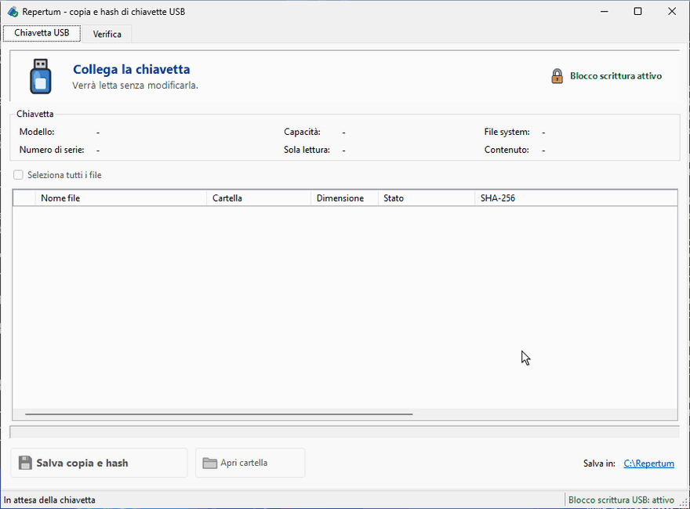
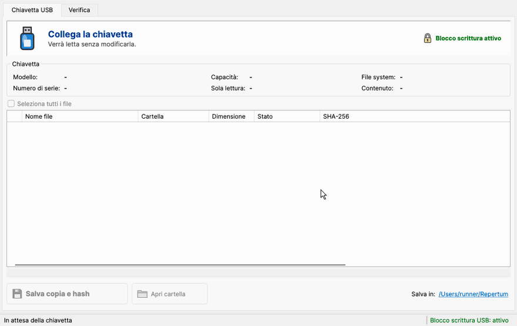
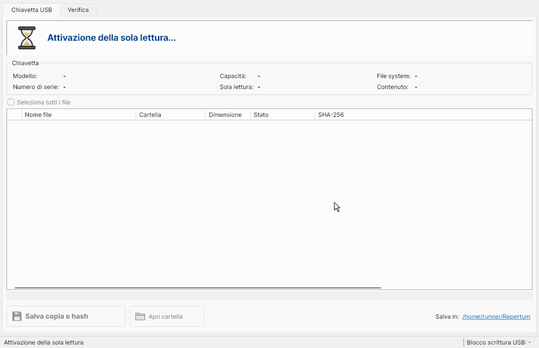
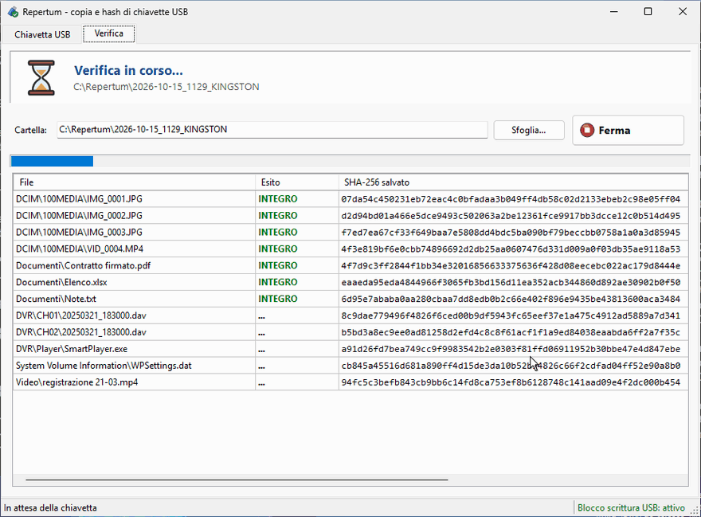
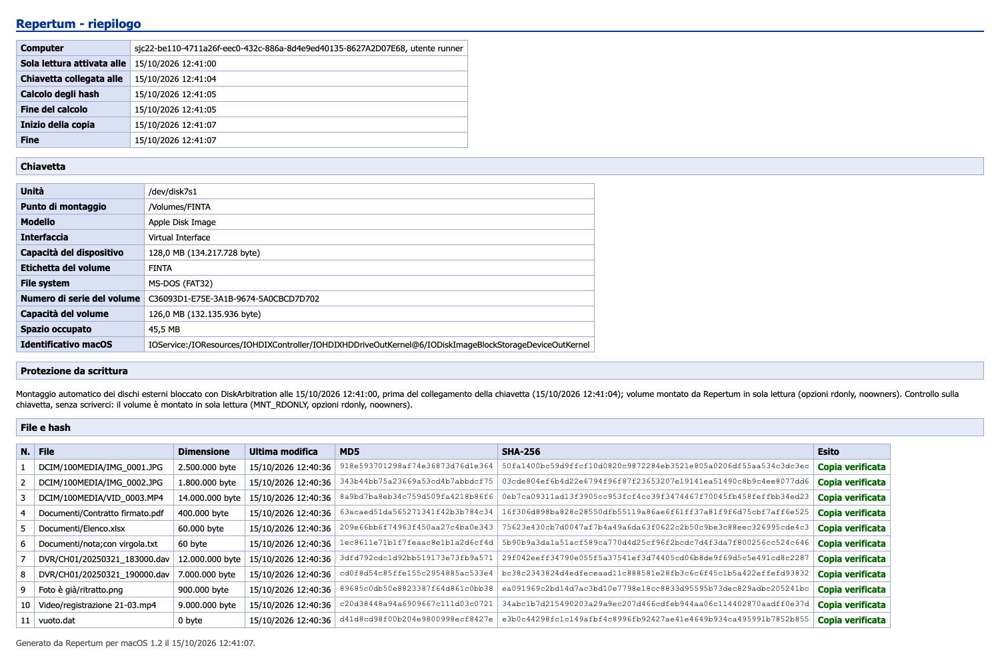

<div align="center">


# Repertum

**Copia i file di una chiavetta USB senza alterarla, con l'hash di ogni file e un report pronto da allegare.**

Blocca la scrittura prima che la chiavetta venga collegata, la legge in sola lettura, calcola SHA-256 e MD5,
copia i file e controlla che ogni copia sia identica all'originale. Una finestra, un pulsante.

[](https://github.com/erold90/repertum/releases/latest)
[](https://github.com/erold90/repertum/actions/workflows/windows.yml)
[](https://github.com/erold90/repertum/actions/workflows/macos.yml)
[](https://github.com/erold90/repertum/actions/workflows/linux.yml)

[](LICENSE)

[**Scarica**](https://github.com/erold90/repertum/releases/latest) · [Come si usa](#come-si-usa) · [Cosa produce](#cosa-trovi-nella-cartella-salvata) · [Come funziona](#come-funziona-il-blocco-della-scrittura) · [Limiti](#limiti) · [English](#in-english)

</div>

<p align="center">
  
  <br>
  <sub>Registrazione vera su Windows, fatta dal collaudo automatico con una chiavetta simulata.</sub>
</p>

## Perché

Collegare una chiavetta a un computer la modifica, anche se non si apre nessun file:

- **Windows** ci crea `System Volume Information`;
- **macOS** ci scrive `.Spotlight-V100`, `.fseventsd` e i file `._`;
- **Linux** può riprodurre il journal di un file system ext4 e aggiornarne la data di montaggio.

Quando la chiavetta è una prova, o un documento da conservare così com'è, queste scritture
sono un problema: cambiano il supporto e mettono in discussione le copie.

Repertum fa le cose nell'ordine giusto:

1. **blocca la scrittura** prima che la chiavetta venga collegata;
2. **controlla** che risulti davvero in sola lettura, senza scriverci;
3. **legge** ogni file e ne calcola SHA-256 e MD5;
4. **copia** i file e **rilegge ogni copia** per confrontarne l'hash con l'originale;
5. **scrive un report** con tutto quello che è successo e quando;
6. alla chiusura **rimette il computer com'era**.

Il nome viene dal latino *repertum*, «ciò che è stato trovato»: in italiano, il reperto.

## Scarica

| Sistema | File | Note |
|---|---|---|
| **Windows** 10 e 11 | [`Repertum.exe`](https://github.com/erold90/repertum/releases/latest/download/Repertum.exe) | Un file da circa 150 KB. Usa .NET Framework 4.8, che Windows ha già |
| **macOS** 12 o successivo, Apple Silicon | [`Repertum-macos-arm64.zip`](https://github.com/erold90/repertum/releases/latest/download/Repertum-macos-arm64.zip) | `Repertum.app` |
| **macOS** 12 o successivo, Intel | [`Repertum-macos-x64.zip`](https://github.com/erold90/repertum/releases/latest/download/Repertum-macos-x64.zip) | `Repertum.app` |
| **Linux** x64 | [`Repertum-linux-x64.tar.gz`](https://github.com/erold90/repertum/releases/latest/download/Repertum-linux-x64.tar.gz) | Un eseguibile. Servono X11 o XWayland e `pkexec` (polkit) |

Non si installa niente e non si collega a internet. Le impronte dei file scaricati sono in
`SHA256SUMS.txt`, accanto a ogni rilascio.

<details>
<summary><b>Il primo avvio</b>: gli avvisi di Windows e macOS</summary>

Repertum non è firmato con un certificato commerciale, quindi la prima volta il sistema avvisa.

- **Windows**: «Windows ha protetto il PC» → *Ulteriori informazioni* → *Esegui comunque*.
  Poi chiede di essere eseguito come amministratore: serve per attivare il blocco della scrittura.
- **macOS**: tasto destro su `Repertum.app` → *Apri* → *Apri*. Sulle versioni più recenti:
  *Impostazioni di Sistema* → *Privacy e sicurezza* → *Apri comunque*. La prima volta che legge
  una chiavetta, macOS può chiedere il permesso di accedere ai volumi rimovibili: va concesso.
- **Linux**: `tar xzf Repertum-linux-x64.tar.gz && ./Repertum/Repertum`. All'avvio chiede la
  password di amministratore (pkexec) per il blocco della scrittura. Nella cartella ci sono anche
  `repertum.desktop` e l'icona, per aggiungerlo al menu delle applicazioni.

</details>

## Come si usa

1. **Apri Repertum prima di collegare la chiavetta.** Se ce n'è già una collegata, ti chiede di scollegarla.
2. **Collega la chiavetta.** Repertum la riconosce, controlla che sia in sola lettura ed elenca i file mentre ne calcola gli hash.
3. **Premi «Salva copia e hash».** I file sono già tutti spuntati; se togli le spunte, salva solo gli hash.
4. **Scollega la chiavetta e chiudi Repertum.** Il computer torna com'era.

Se accanto a «Blocco scrittura» compare un **avviso rosso**, la chiavetta non risulta in sola lettura:
scollegala, riavvia il computer e riprova.

### Anche su macOS e Linux

Stessa finestra, stesso pulsante, stessi file prodotti.

<table>
  <tr>
    <td width="50%"></td>
    <td width="50%"></td>
  </tr>
  <tr>
    <td align="center"><sub>macOS: la chiavetta viene montata in sola lettura da Repertum</sub></td>
    <td align="center"><sub>Linux: la chiavetta diventa di sola lettura per il kernel</sub></td>
  </tr>
</table>

### Ricontrollare le copie

<p align="center">
  
</p>

Nella scheda **Verifica** scegli una cartella salvata da Repertum (oppure trascinala su `Repertum.exe`):
ogni file viene riletto e confrontato con gli hash salvati. Basta un byte diverso perché il file risulti
**alterato**. Serve prima di consegnare o caricare le copie, anche a distanza di anni.

## Cosa trovi nella cartella salvata

Ogni salvataggio va in una cartella nuova, chiamata con data, ora ed etichetta della chiavetta:
`C:\Repertum\2026-10-15_1030_KINGSTON` su Windows, `~/Repertum/…` su macOS e Linux.
Si può sceglierne un'altra con **Salva in**, prima di salvare.

```text
2026-10-15_1030_KINGSTON/
├── File/              le copie, con le stesse cartelle della chiavetta (in sola lettura)
├── RIEPILOGO.txt      il report: orari, chiavetta, protezione, ogni file con i suoi hash
├── RAPPORTO.html      lo stesso report impaginato, da stampare
├── HASH.sha256        gli hash SHA-256, nel formato di sha256sum
├── HASH.md5           gli hash MD5, nel formato di md5sum
├── INVENTARIO.csv     tutti i file con dimensione, date e hash; si apre con Excel
└── LOG.txt            ogni operazione con il suo orario
```

`HASH.sha256` e `HASH.md5` si possono controllare anche senza Repertum:

```sh
cd 2026-10-15_1030_KINGSTON/File
sha256sum -c ../HASH.sha256        # Linux
shasum -a 256 -c ../HASH.sha256    # macOS
```

<details>
<summary><b>Il report da stampare</b> (RAPPORTO.html)</summary>
<br>
<sub>Un rapporto vero, prodotto dal collaudo su macOS con una chiavetta simulata.</sub>
<br>

</details>

## Come funziona il blocco della scrittura

<!-- WINDOWS -->
### Windows

All'avvio Repertum attiva il criterio di sistema `StorageDevicePolicies\WriteProtect`: da quel momento
Windows monta **in sola lettura** ogni dispositivo di archiviazione USB che viene collegato.
Il criterio vale solo per i dispositivi collegati dopo, ed è per questo che la chiavetta va collegata
a Repertum già aperto. Alla chiusura il criterio torna esattamente com'era. Se il programma si
interrompe, lo stato precedente resta annotato in `HKLM\SOFTWARE\Repertum`: basta riaprire e
richiudere Repertum.

Collegata la chiavetta, Repertum controlla, senza scriverci, che il volume sia montato in sola lettura
(`FILE_READ_ONLY_VOLUME`) e che il disco risponda «protetto da scrittura» (`IOCTL_DISK_IS_WRITABLE`).
Il report riporta l'ora di attivazione del blocco, l'ora del collegamento e l'esito del controllo.

### macOS

Repertum usa **Disk Arbitration**, il servizio con cui macOS monta i dischi, e non chiede la
password di amministratore. All'avvio registra un controllo che **rifiuta il montaggio automatico**
dei dischi esterni; quando colleghi la chiavetta, la monta lui stesso **in sola lettura**
(`rdonly`, `noowners`). Così Finder, Spotlight e `fseventsd` non possono scriverci: niente
`.Spotlight-V100`, `.fseventsd` o file `._`. Poi controlla con `statfs` che il volume sia davvero
montato in sola lettura (`MNT_RDONLY`).

Se il programma si chiude, anche all'improvviso, macOS toglie da solo il controllo: il Mac torna a
montare i dischi come prima.

### Linux

All'avvio Repertum chiede la password di amministratore con `pkexec` e avvia un piccolo aiutante
con i permessi necessari. L'aiutante installa una regola udev temporanea
(`/run/udev/rules.d/00-repertum.rules`): ogni disco USB collegato viene ignorato dal montaggio
automatico del desktop (`UDISKS_IGNORE`) e reso **di sola lettura per il kernel**
(`blockdev --setro`) prima che chiunque possa montarlo. Poi la chiavetta viene montata in sola
lettura con le opzioni giuste per ogni file system: per esempio `noload` per ext4, così il journal
non viene riprodotto. Repertum controlla `/sys/block/…/ro` e `statvfs` (`ST_RDONLY`).

Alla chiusura, o se la finestra si chiude all'improvviso, l'aiutante smonta la chiavetta, toglie la
regola e ricarica udev.


### Gli hash

SHA-256 e MD5 vengono calcolati in un'unica lettura di ogni file, con le librerie crittografiche
del sistema. Dopo la copia ogni file copiato viene **riletto dal disco di destinazione** e il suo
SHA-256 confrontato con quello dell'originale. Solo allora la riga diventa «Copia verificata» e la
copia viene messa in sola lettura.

## Limiti

Meglio saperli prima:

- **È un blocco software, non un write-blocker hardware.** Si affida al sistema operativo. Quando
  serve la massima garanzia, un write-blocker hardware resta la scelta più solida.
- **Copia i file, non fa un'immagine del disco.** File cancellati, spazio non allocato e tabella
  delle partizioni non vengono acquisiti. Per una copia bit a bit servono strumenti come
  FTK Imager, `dc3dd` o Guymager.
- **La chiavetta va collegata dopo l'avvio.** Una chiavetta già collegata non è protetta.
- **Mentre Repertum è aperto, tutte le chiavette collegate sono in sola lettura**, anche quella
  su cui vorresti salvare. Salva sul disco del computer, chiudi Repertum, poi copia la cartella
  dove ti serve.
- **Su macOS, mentre Repertum è aperto, nessun disco esterno si monta da solo**: li monta Repertum,
  in sola lettura. Su Linux i file di un file system ext4 che l'utente non ha il permesso di leggere
  risultano «NON LEGGIBILE».
- **Il collaudo automatico usa chiavette simulate**: un disco virtuale su Windows, un'immagine disco
  su macOS, un dispositivo loop su Linux. Con una chiavetta USB vera è stato provato finora solo
  macOS (vedi sotto). Prima di usarlo su qualcosa che conta, fai una prova con una chiavetta
  qualunque e controlla che compaia «Sola lettura: Sì, verificata».
- L'interfaccia è solo in italiano.

Repertum non è uno strumento certificato. È distribuito con licenza MIT, senza garanzie: verifica che
il suo uso sia adatto al tuo caso.

## Collaudo

Ogni modifica passa da GitHub Actions su Windows, macOS e Linux:

1. compilazione e schermate di tutti gli stati con dati finti;
2. **flusso vero**: si avvia Repertum, si collega una chiavetta simulata, si salva tutto;
3. gli hash prodotti vengono confrontati con quelli calcolati dagli strumenti del sistema
   (`Get-FileHash`, `shasum`, `sha256sum`) e le copie con gli originali;
4. su macOS e Linux l'**impronta dell'immagine del disco** deve essere identica prima e dopo:
   la prova che la chiavetta non è stata toccata;
5. alla chiusura il computer deve essere tornato com'era (criterio di Windows, Disk Arbitration,
   regola udev).

Le GIF di questa pagina vengono dallo stesso collaudo: le registra il workflow
[`GIF della documentazione`](.github/workflows/gif.yml).


### Prova con una chiavetta vera (macOS, 15/10/2026)

Chiavetta USB da 2 GB, FAT32, 1.453 file, su un MacBook Pro Intel con macOS 15. L'impronta
SHA-256 del **disco intero** (2.003.795.968 byte, letti con `/usr/libexec/authopen`) è stata
calcolata con la chiavetta smontata, prima e dopo il lavoro di Repertum:

```
prima  3a7a25f2dc48ede445e70a09467126fd3074854693f6dd31843d0c78b6f599cc
dopo   3a7a25f2dc48ede445e70a09467126fd3074854693f6dd31843d0c78b6f599cc
```

Nel frattempo Repertum ha montato la chiavetta in sola lettura (`read-only, noowners`), ha
calcolato gli hash e copiato i 1.453 file, con hash uguali a quelli di `shasum -a 256` sia sulla
chiavetta sia sulle copie.

Per confronto: fra due prove la chiavetta è stata collegata una volta senza Repertum, e il normale
montaggio di macOS ci ha scritto tre file nuovi in `.fseventsd/`. È proprio quello che il blocco
impedisce.

## Struttura

```text
src/
├── Repertum.Core/       hash, report, verifica: il codice comune alle tre piattaforme
├── Repertum.Windows/    l'app Windows (WinForms, .NET Framework 4.8)
└── Repertum.Desktop/    l'app macOS e Linux (Avalonia, .NET 8)
tools/gif/               registrazione e composizione delle GIF
.github/workflows/       collaudo per piattaforma, GIF, rilascio
```

Per compilare e contribuire: [CONTRIBUTING.md](CONTRIBUTING.md). Per segnalare un problema di
integrità in privato: [SECURITY.md](SECURITY.md). Le novità di ogni versione: [CHANGELOG.md](CHANGELOG.md).

## In English

**Repertum** copies the files of a USB stick **without altering it**. It enables a write block
*before* the stick is plugged in (Windows `StorageDevicePolicies`, macOS Disk Arbitration, Linux
udev + `blockdev --setro`), checks that the volume is really read-only, computes SHA-256 and MD5 of
every file, copies them and re-reads every copy to verify it. It then writes a report
(`RIEPILOGO.txt`, `RAPPORTO.html`, `HASH.sha256`, `HASH.md5`, `INVENTARIO.csv`, `LOG.txt`).
It is a software write block, not a hardware one, and it copies files rather than imaging the disk.
The interface is Italian only. MIT licensed.

## Licenza

[MIT](LICENSE) © 2026 Daniele Lo Re
